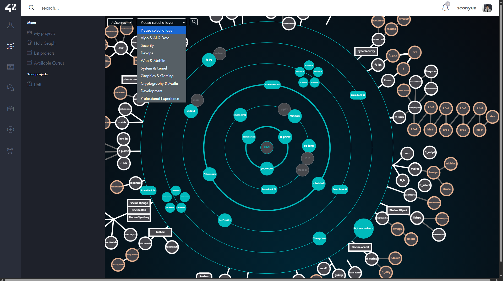

# 42 Projects

42서울에서 수행한 프로젝트를 정리한 저장소입니다. 각 프로젝트에서 구현한 기능과 사용한 언어/기술을 간단히 기록했습니다. 42서울에서 진행한 다양한 프로그래밍 작업을 다루고 있으며, 커스텀 라이브러리 제작, 시스템 프로그래밍, 네트워크 통신, 게임 개발 등 다양한 주제와 기술을 포함하고 있습니다.

  

  42서울 커리큘럼 및 프로젝트 이수 현황

---

## Libft
- **언어/기술:** C
- **설명:** 표준 C 라이브러리의 주요 함수를 직접 구현한 프로젝트입니다.
- **구현 내용:**
  - 문자열 처리 함수 구현
  - 메모리 조작 함수 구현
  - 연결 리스트 생성, 추가, 순회, 삭제 함수 구현
  - 라이브러리 형태로 묶어 이후 프로젝트에서 재사용 가능하도록 구성

## ft_printf
- **언어/기술:** C
- **설명:** `printf`와 유사한 출력 함수를 구현한 프로젝트입니다.
- **구현 내용:**
  - 가변 인자 처리
  - 포맷 문자열 파싱
  - 문자, 문자열, 정수, 16진수, 포인터 등 서식 지정자별 출력 로직 구현
  - 출력 길이 반환 처리 및 예외 케이스 대응

## get_next_line
- **언어/기술:** C
- **설명:** 파일 디스크립터에서 한 줄씩 읽어오는 함수를 구현한 프로젝트입니다.
- **구현 내용:**
  - 버퍼 단위 입력 처리
  - 개행 문자 기준 줄 분리
  - 정적 변수를 활용한 잔여 데이터 관리
  - EOF 및 예외 상황 처리
  - 동적 메모리 할당 및 해제 로직 구성

## Born2beroot
- **언어/기술:** Debian, VirtualBox, Shell
- **설명:** Debian 기반 가상 서버 환경을 구성한 프로젝트입니다.
- **구현 내용:**
  - VirtualBox 기반 가상 머신 설정
  - Debian 서버 초기 환경 구성
  - 사용자 및 그룹 생성, 권한 분리
  - sudo 정책 설정
  - UFW 방화벽 설정
  - LVM 구성 및 디스크 구조 설정

## Minitalk
- **언어/기술:** C, UNIX Signal
- **설명:** UNIX 시그널을 이용해 프로세스 간 통신을 구현한 프로젝트입니다.
- **구현 내용:**
  - 클라이언트/서버 구조 구현
  - 시그널 단위 데이터 전송
  - 문자 단위 메시지 인코딩 및 디코딩 처리
  - 서버에서 수신한 데이터를 순서대로 복원하는 로직 구현
  - 메시지 전송 완료 흐름 처리

## so_long
- **언어/기술:** C, MiniLibX
- **설명:** 2D 맵 기반 게임을 구현한 프로젝트입니다.
- **구현 내용:**
  - 맵 파일 파싱 및 유효성 검사
  - 플레이어 위치, 벽, 아이템, 출구 데이터 처리
  - 키보드 입력 기반 이동 로직 구현
  - 충돌 판정 및 이동 가능 여부 처리
  - 오브젝트 및 맵 화면 렌더링
  - 게임 종료 조건 처리

## push_swap
- **언어/기술:** C
- **설명:** 제한된 명령어만으로 숫자를 정렬하는 프로젝트입니다.
- **구현 내용:**
  - 스택 자료구조 구현
  - `sa`, `sb`, `pa`, `pb`, `ra`, `rb`, `rra`, `rrb` 등 명령어 동작 구현
  - 피벗 기반 분할 정렬 로직 적용
  - 입력 크기에 따라 정렬 방식 분리
  - 작은 케이스에 대한 별도 처리 로직 구성
  - 연산 횟수를 줄이는 방향으로 명령어 조합 정리

## Minishell
- **언어/기술:** C, UNIX System Call
- **설명:** UNIX 셸의 주요 기능을 구현한 팀 프로젝트입니다.
- **구현 내용:**
  - 명령어 입력 파싱
  - 토큰 분리 및 실행 단위 구성
  - `fork`, `execve` 기반 프로세스 실행 처리
  - 파이프라인 연결 처리
  - 입출력 리디렉션 처리
  - 시그널 대응 로직 구성
  - 빌트인 명령어 실행 흐름 구성
  - 파서와 실행 모듈 간 인터페이스 정리 및 통합 디버깅

## Philosopher
- **언어/기술:** C, pthread, mutex
- **설명:** 식사하는 철학자 문제를 구현한 멀티스레딩 프로젝트입니다.
- **구현 내용:**
  - 철학자별 스레드 생성 및 실행
  - 포크 자원을 mutex로 관리
  - 식사, 수면, 생각 상태 전환 로직 구현
  - 시간 기준 생존 여부 체크
  - 데드락 방지를 위한 락 순서 및 실행 흐름 조정
  - 로그 출력 및 상태 모니터링 처리

## CPP Modules
- **언어/기술:** C++
- **설명:** C++ 객체지향 문법과 구조를 구현한 프로젝트입니다.
- **구현 내용:**
  - 클래스 설계 및 객체 생성/소멸 흐름 구현
  - 상속 구조 구성
  - 가상 함수 기반 다형성 적용
  - 추상 클래스 및 인터페이스 형태 구현
  - 연산자 오버로딩
  - 복사 생성자, 대입 연산자, 소멸자 처리
  - 예외 처리 로직 구성
  - 템플릿 및 STL 기반 자료구조 활용

## NetPractice
- **언어/기술:** Network
- **설명:** IP, 서브넷, 라우팅 등 네트워크 구성을 다룬 프로젝트입니다.
- **구현 내용:**
  - IP 주소와 서브넷 마스크 계산
  - 네트워크/브로드캐스트 주소 구분
  - 서브넷 분할 구성
  - 라우터와 호스트 간 연결 관계 설정
  - 라우팅 경로에 따른 통신 가능 여부 확인

## Cub3D
- **언어/기술:** C, MiniLibX
- **설명:** 레이캐스팅 기반 3D 렌더링을 구현한 프로젝트입니다.
- **구현 내용:**
  - 맵 파일 파싱 및 2D 맵 데이터 구성
  - 플레이어 위치와 시야 방향 처리
  - 레이캐스팅 계산
  - 벽 충돌 지점 계산
  - 화면 열 단위 거리 계산 및 원근 반영
  - 텍스처 매핑 및 벽 렌더링
  - 키 입력 기반 이동 및 시점 회전 처리

## Inception
- **언어/기술:** Docker, Docker Compose, Shell Script
- **설명:** Docker 기반으로 다중 서비스 환경을 구성한 프로젝트입니다.
- **구현 내용:**
  - Nginx, WordPress, MariaDB, Redis 컨테이너 구성
  - Docker Compose 기반 서비스 통합
  - 서비스별 설정 파일 분리
  - 컨테이너 간 네트워크 연결 설정
  - 볼륨 구성 및 데이터 유지 처리
  - 실행 및 초기 설정 자동화를 위한 스크립트 작성

## ft_irc
- **언어/기술:** C++, Socket Programming
- **설명:** IRC 서버를 구현한 프로젝트입니다.
- **구현 내용:**
  - 소켓 생성 및 서버 연결 처리
  - `select` 기반 다중 클라이언트 연결 처리
  - 클라이언트 인증 및 접속 상태 관리
  - 채널 생성 및 입장/퇴장 처리
  - 사용자 권한 및 채널 권한 관리
  - IRC 명령어 파싱 및 실행
  - 클라이언트 간 메시지 전달 및 브로드캐스트 처리

## ft_transcendence
- **언어/기술:** TypeScript, JavaScript, NestJS, React, PostgreSQL
- **링크:** [ft_transcendence backend](https://github.com/ft-transcendence-seoul/backend)
- **설명:** 웹 기반 실시간 게임 애플리케이션을 구현한 팀 프로젝트입니다.
- **담당:** 채널 기능 구현
- **구현 내용:**
  - 채널 생성, 입장, 퇴장 기능 구현
  - 채널 초대 요청 및 초대 수락/거절 처리 구현
  - 방장 권한 위임 기능 구현
  - 관리자 권한 부여 및 회수 기능 구현
  - 강퇴, 차단, 뮤트 기능 구현
  - NestJS 기반 REST API 작성
  - PostgreSQL 기반 채널, 사용자, 권한 데이터 연동
  - Postman을 활용한 API 테스트 및 기능별 시나리오 검증
  - 에러 응답 및 예외 처리 로직 정리
